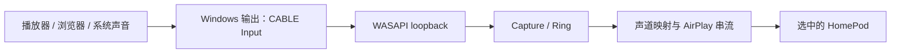

# HomePodCast 虚拟音频输出：实现分析与开发计划

> 2026-10-28 方向更新：用户接受一个 HomePodCast 安装包内含第三方驱动。当前优先采用已有签名的标准 VB-CABLE，完成一体安装与自动路由；自有驱动不再是满足“不同时出声”需求的前置条件。实施顺序和分发依据见 [单安装包方案](SINGLE_INSTALLER_PLAN.zh-CN.md)。下文保留最初规划，不代表当前完成状态。

日期：2026-10-22。分析基线：`zlsun2000/HomePodCast` 的 `main`，提交 `cca19b550b646a04318d8f8675f92511fb4de53c`，应用版本 `1.2.1`。

本次已完成仓库克隆、源码分析和官方资料核对；本文是待实施方案。尚未安装虚拟声卡、改变系统默认设备或进行 HomePod 实机验证。文中工期与验收阈值是规划值，不是已测结果。

## 1. 建议与交付范围

建议按“现成虚拟声卡接入 → 自动切换与恢复 → 自有驱动”推进。

第一阶段能够解决电脑和 HomePod 同时出声的核心问题，而且基本沿用现有音频传输链路。真正以产品自带的 `HomePodCast Audio` 身份出现在 Windows 中，需要后续提供、安装和维护音频驱动；给 Python 应用增加一个设备名称不能创建系统音频端点。

| 用户需求 | 第一阶段 | 第二阶段 |
| --- | --- | --- |
| 本地音箱不跟随播放 | 音频送到 VB-CABLE，捕获该虚拟端点 | 自有虚拟输出端点 |
| 自动选择采集源 | 识别、记忆并验证虚拟端点 ID | 按自有驱动身份识别 |
| Windows 中切换输出 | 切换到 `CABLE Input` 或物理音箱 | 切换到 `HomePodCast Audio` |
| Windows 音量、静音 | 在验证过的驱动配置下支持 | 明确实现端点音量语义 |
| 停止、断连后恢复 | 可选，按设备角色和切换归属恢复 | 复用第一阶段的路由管理 |
| 无需单独安装第三方驱动 | 暂不提供 | 正式签名的安装包 |

“本地不出声”的范围是送入虚拟设备的应用音频。固定使用物理音箱的应用、独占模式应用或启用了监听转发的软件，仍可能从物理音箱播放；不能仅靠更改系统默认设备保证所有程序迁移。

## 2. 当前代码适配点

| 位置（基线行号） | 现状 | 实施影响 |
| --- | --- | --- |
| `engine.py:253`，`list_sources()` | SoundCard 枚举所有输出设备，把默认设备排在前面 | 已安装且可用的虚拟输出原则上会进入列表；补充类型、状态、刷新和无默认设备处理 |
| `engine.py:262`，`Capture` | 通过保存的设备 ID 调用 `get_microphone(..., include_loopback=True)`，44.1 kHz 采集 | 优先复用虚拟播放端点的 loopback；补充启动就绪、超时与关闭完成通知 |
| `engine.py:292`，`routing_matrix()` | 按实际输入声道映射到 1、2、4 台 HomePod | 保留；虚拟输入为双声道时，四台模式仍是后置重复前置 |
| `engine.py:627`，`Engine._start()` | 先连接所有 HomePod，启动采集线程后立即进入 streaming | 不能直接用当前 streaming 状态作为自动切换的充分条件 |
| `engine.py:663`，`Engine._stop()` | 停止发送、重连及采集；采集线程只置停止标记，没有等待退出 | 增加有界关闭，并统一覆盖失败、取消和重复停止 |
| `engine.py:714` / `776` | 支持单台重连；允许全部离线后继续等待 | 将“接收端重连”与“系统输出恢复策略”分开处理 |
| `app.py:331` / `373` | 音源列表仅启动时读取；保存 ID 找不到时选列表第一项 | 虚拟模式下禁止无提示回退到物理音箱 |
| `app.py:670`，`remember()` | 整体重建配置字典 | 新增字段必须纳入保存与迁移，避免切换语言等操作丢失设置 |
| `app.py:849` / `936` | 负责开始、停止、退出；退出最多等 3 秒且吞掉异常 | 停止和恢复须集中管理，不能依赖一个 UI 回调 |
| `app.py:907`，`apply_volume()` | 滑块通过 RTSP 调 HomePod 接收端音量 | 与 Windows 虚拟端点音量是两个独立控制层 |
| `app.py:26` / `807` | 更新地址指向 `GeoAtom/HomePodCast`；升级会重启 | 自用 fork 发布前调整更新来源，避免更新回上游而丢掉功能 |
| `.github/workflows/build.yml` | 安装依赖、PyInstaller 打包、检查 EXE 版本 | 新增路由单元测试；驱动测试另建流程 |

仓库没有现成的系统默认输出切换层，也没有自动化测试目录。AirPlay 握手、同步时钟、声道分发与自动网络缓冲可以继续使用。

## 3. 第一阶段音频路径



这里的命名容易混淆：`CABLE Input` 是给 Windows 应用播放用的输出设备；`CABLE Output` 是另一端供录音程序读取的输入设备。

首选捕获 **CABLE Input 的 loopback**，不必绕到录音端。VB-CABLE 官方手册第 13 页说明新驱动支持此路径，loopback 选项默认开启。这样最贴合当前实现，也应优先测量其延迟。[VB-CABLE 手册](https://vb-audio.com/Cable/VBCABLE_ReferenceManual.pdf)

若目标版本的 loopback 无法通过验证，再提供显式的 `capture_endpoint` 后备模式，读取 CABLE Output。此时需要增加输入设备枚举、关联两个端点并单独验证采样率、音量和额外缓冲；不要在运行中悄悄改换采集路径。SoundCard 的上游实现可供参考，但本项目锁定的 `0.4.6` 行为仍须实测。[SoundCard Windows 后端](https://github.com/bastibe/SoundCard/blob/master/soundcard/mediafoundation.py)

### 3.1 安装和设备识别

- 首版提供 VB-CABLE 官网入口、安装说明、刷新设备按钮。安装需要管理员权限且官方要求重启，应用本身保持普通用户权限。[官方下载与安装说明](https://vb-audio.com/Cable/index.htm)
- 首版不捆绑驱动安装文件；若以后集成安装器，应先确认相应再分发许可和安装方式，不能把“可下载使用”等同于“可随产品重新分发”。
- 保存 Windows endpoint ID；友好名称只用于显示和候选推荐，不能作为唯一匹配条件。
- 新安装首次推荐可结合厂商、设备属性、播放/录音方向和名称；多个候选或身份不明确时让用户选择。设备重装后 ID 可能改变，重新绑定而非猜测。
- 虚拟设备缺失、禁用或格式不支持时，显示明确状态；保留原有物理 loopback 模式供用户主动选择。
- 通过 `IMMNotificationClient` 更新新增、移除、默认设备变化；COM 回调只投递事件，不直接操作 Tk UI。[MMDevice API](https://learn.microsoft.com/en-us/windows/win32/coreaudio/mmdevice-api)

### 3.2 音量策略：先验证，避免重复衰减

VB-CABLE 手册说明 Windows Volume Control 是一个可启用的选项；未启用时音量滑块可能没有效果。因此，“选中虚拟设备”不代表 Windows 音量一定正确生效。[VB-CABLE 手册，第 13 页](https://vb-audio.com/Cable/VBCABLE_ReferenceManual.pdf)

首版选择以下语义：

1. Windows 音量和静音控制虚拟端点送入串流的信号；对正式支持的驱动版本、设置和采集路径做实测。
2. 当前应用滑块标为“HomePod 音量”，继续控制接收端增益；不把 HomePod 强行设为 100%。
3. 在原生端点音量已作用于采集信号时，不再按同一 Windows 滑块对 PCM 或 RTSP 音量额外乘一次。
4. Windows 静音需要覆盖软件注入的测试音；当前 `chime` 绕过音源，必须明确定义静音时禁用/抑制测试音，并在 UI 说明。

如果支持目标的采集信号确实不随端点音量变化，才考虑显式的兼容模式：订阅 `IAudioEndpointVolumeCallback`，在发送前实现单一增益与静音。使用端点 dB 值换算 `10^(dB/20)`，不要假设 Windows 0–100 滑块就是线性 PCM 增益；包含短增益渐变避免爆音。不得仅根据一段静音样本自动判定增益能力。[EndpointVolume 文档](https://learn.microsoft.com/en-us/windows/win32/api/endpointvolume/nn-endpointvolume-iaudioendpointvolume)

Windows 主音量可用不等于 Windows 与 HomePod 音量数值双向同步；第一阶段不承诺两者或 Siri 调音后的双向同步。

## 4. 自动切换、恢复与生命周期

### 4.1 Windows 控制层

新增 `windows_audio.py`，集中封装设备枚举、默认设备读取、通知订阅和默认设备设置。优先评估 `pycaw + comtypes` 并锁定验证过的版本，不在 GUI 和引擎中散落 COM vtable 定义。

读取默认设备和监听变化可以用公开的 MMDevice API。其公开接口没有设置系统默认设备的方法；自动设置通常使用 `IPolicyConfig::SetDefaultEndpoint`。pycaw 上游已有此类封装，但它仍是 Windows 非公开接口的兼容性依赖，不能当成微软稳定 API 承诺。须隔离适配、检查 HRESULT 并读回验证，失败时保留手动切换入口。[IMMDeviceEnumerator](https://learn.microsoft.com/en-us/windows/win32/api/mmdeviceapi/nn-mmdeviceapi-immdeviceenumerator)、[pycaw 实现](https://github.com/AndreMiras/pycaw/blob/main/pycaw/utils.py)

默认只操作 `eConsole` 与 `eMultimedia`；`eCommunications` 保持用户设置，另设可选开关。每个角色分别记录原设备和实际修改结果，不能用一个“旧音箱 ID”覆盖所有角色。不更改默认麦克风。

### 4.2 启动事务

新增 `audio_session.py` 作为单一生命周期协调层，UI、托盘退出、自动启动、异常清理均经过它：

1. 验证虚拟端点存在、方向正确、可打开，读取实际声道；为本次会话分配唯一 ID。
2. 开始 HomePod 连接和采集初始化；等待采集明确报告 recorder 已打开。静音时没有音频包是正常情况，不以非零电平作为就绪条件。
3. 等待发送循环启动及必要的接收端就绪信号；已有 timing 请求可以作为连接健康信号，但并不证明扬声器实际发声。设置有限超时并在失败时清理。
4. 在真正切换前读取各角色当前默认值，写入可恢复日志。连接期间若用户修改默认输出，应放弃本次自动接管，避免覆盖刚发生的手动选择。
5. 对开启的角色逐个切换到虚拟端点，记录并读回实际结果。部分成功后失败，只回滚本次已修改且仍归本次会话管理的角色。
6. 切换完成后丢弃切换前积压的采集帧，再进入就绪状态。任何异常、取消或超时都走同一清理路径。

路由操作和启动/停止操作串行化；使用会话代号忽略迟到的连接回调。COM 对象在所属线程内创建、使用和释放，跨线程仅传递 ID/普通数据。

### 4.3 恢复条件

恢复某个角色必须同时满足：本会话确实修改了该角色、当前默认仍是本会话设置的虚拟端点、原端点仍可用，且未观察到用户接管该角色。

- 用户手动换到耳机/音箱后，该角色立即失去自动恢复归属；不抢回虚拟输出。
- 用户手动选回虚拟设备，也不自动重新获取归属；下一次显式开始才建立新事务。
- 启动前默认已是虚拟设备时，不凭空猜测一个“上次音箱”。
- 原设备拔出时，不随便切到列表第一项；提示用户手动选输出，或使用用户事先配置的备用设备。
- MMDevice 设置与用户操作没有跨进程原子比较交换保证。实现时在写入前复查、写入后读回，结合通知保守放弃有冲突的角色，避免承诺绝对无竞态。

### 4.4 断连策略

| 场景 | 建议行为 |
| --- | --- |
| 关闭窗口但仍在托盘 | 保持串流与路由，不恢复 |
| 点击停止、托盘退出、正常升级重启 | 按归属条件恢复；幂等清理；升级后重新建立会话 |
| 部分 HomePod 离线，允许重连 | 其余继续播放，不恢复系统输出 |
| 全部离线，允许重连 | 默认继续等待；若用户开启“全部断连后恢复”，确认离线后再等待 10 秒，随后停止并恢复 |
| 禁用重连，任一 HomePod 失联 | 与当前停止语义一致，增加条件恢复 |
| 虚拟端点被移除或采集失败 | 终止会话，执行条件恢复并报告原因 |
| 用户手动改默认输出 | 尊重选择；仍固定采集原虚拟端点，不能跟随新的物理默认源 |
| 系统休眠、唤醒或音频服务重启 | 使旧采集实例失效并重新验证；不得直接沿用旧 COM 句柄或抢回路由 |

10 秒是建议的额外宽限期，从引擎确认全部离线时开始计时。当前连接检测本身也有反馈超时和检查周期，因此不能宣传为“断网后 10 秒必定恢复”。恢复物理输出会让声音重新在本地播放，所以断连恢复默认关闭，交由用户启用。

### 4.5 退出与崩溃

新增独立的 `routing-state.json`，记录 schema、会话 ID、进程身份、逐角色 before/target/归属和事务阶段；用临时文件原子替换。配置文件保存偏好，恢复日志保存未完成事务，二者分开。

正常停止时先终止发送，再按条件恢复，最后有界等待采集线程及网络连接释放；恢复不能被某个网络 teardown 长时间阻塞。`app.py` 的固定 3 秒等待须与这一关闭预算协调。测试音独立会话不应触发系统默认设备切换。

应用下次启动可检查旧进程已退出、日志身份有效且当前默认仍匹配目标，再提示恢复。进程崩溃、强杀或机器断电时，不能依靠 `finally` 立即恢复；若后续要求强杀后即时恢复，需要另做受约束的监护进程，并验证进程身份与会话归属。首版不承诺该能力。

## 5. UI 与配置

设置中增加“音频来源模式”：现有输出设备 / 虚拟声卡。虚拟模式展示设备、驱动检测状态、刷新、安装指南和音量配置说明。

配置建议：

```json
{
  "schema_version": 2,
  "audio_mode": "virtual",
  "virtual_render_id": "<Windows endpoint ID>",
  "capture_kind": "render_loopback",
  "capture_endpoint_id": "<Windows endpoint ID>",
  "auto_switch_output": false,
  "switch_communications": false,
  "restore_on_stop": true,
  "restore_on_disconnect": false,
  "disconnect_grace_seconds": 10,
  "volume_mode": "native_endpoint"
}
```

此例表示用户选择虚拟模式后的配置。老配置迁移保持原来源和模式，自动切换默认关闭；通过一次清晰的设置选择启用。运行日志不写入该偏好对象。现有 HomePod 分组、缓冲、语言和开机自启设置需要完整保留。

启动失败提示应区分：未安装、设备不可用、格式不支持、采集初始化失败、HomePod 不可达、自动切换不兼容。设备列表为空时仍可进入设置页面，不应因索引访问退出。

## 6. 分阶段开发任务

工期估算按一名熟悉 Python/Windows 音频的开发者、有 HomePod 和测试 Windows 环境计算；阶段依次执行，不包含驱动安装等待、证书申请等外部耗时。

| 阶段 | 任务与代码范围 | 完成条件 | 估计 |
| --- | --- | --- | --- |
| P0：技术验证 | 新增小型诊断工具；用锁定的 SoundCard、VB-CABLE 验证端点、44.1/48 kHz、音量/静音、loopback 与必要时录音端路径；记录环境 | 核心路径真实播到 HomePod，物理音箱无该路由声音，形成测试报告 | 0.5–1 天 |
| P1：手动虚拟模式 | 改 `engine.py`、`app.py`；增加设备模型、就绪信号、缺失处理、刷新、安装引导和配置迁移 | 用户手动选择虚拟输出即可稳定串流；原模式可用 | 2–3 天 |
| P2：自动路由 | 新增 `windows_audio.py`、`audio_session.py`、恢复日志；集成启动/退出/异常/重连；逐角色回滚、用户接管处理 | 启动失败不遗留错误路由，正常停止正确恢复，手动切换不被覆盖 | 3–5 天 |
| P3：验收与发布准备 | 路由状态测试、Windows/HomePod 矩阵、更新来源、PyInstaller、中文英文指南 | 验收矩阵通过，EXE 可运行，已知限制与支持环境明确 | 2–3 天 |
| P4：内置驱动研究 | 单独原型工程、驱动传输和音量设计、签名/安装方案、实机验证 | 满足下一节立项门槛后再决定产品化 | 先做 3–5 天选型；完整开发另估 |

第一阶段完整版本约 8–12 个工作日；可先以约 3–4 天的小版本交付手动虚拟模式。P0 若证明需要替换采集后端，应重新估时，不把后端重写隐藏在上述范围内。

建议按 P1、P2、P3 分别组织可审查提交/PR。首个版本优先验证立体声；保留多 HomePod 路由，但不凭设备名称宣称支持独立 5.1/7.1，需读取并测试实际格式和声道掩码。

## 7. 验收与测试

纯逻辑测试用假的设备控制层和引擎事件，不依赖真实 HomePod：覆盖各角色不同旧设备、部分切换失败、写日志失败、取消启动、迟到回调、重复停止、用户接管、原设备移除、残留日志和版本迁移。重点验证“何时可以恢复”而非只断言函数被调用。

实机测试以 Windows 11 x64 为首要环境，Windows 10 x64 为兼容性环境；记录 OS build、虚拟驱动版本/选项、依赖版本、HomePod 型号/系统版本。ARM64 与其他虚拟驱动未通过前不列为支持。

| 项目 | 验收方式 |
| --- | --- |
| 独立输出 | 播放已知测试音，确认 HomePod 有声、物理输出无该路由声音；确认未启用“侦听此设备”或额外监听转发 |
| 音量和静音 | Windows 100/50/10/0、mute/unmute，录取 PCM RMS；非零音量单调变化，静音正确，测试音遵循所定义策略；同时检查 HomePod 滑块没有重复衰减 |
| 开始失败 | 断网、HomePod 忙、采集打开失败和切换部分失败；原路由完整保留或按记录回滚 |
| 音源静默 | 无应用播放时也可就绪；随后播放恢复，无因“无包”造成的假失败 |
| 用户手动切换 | 切到耳机、再切回虚拟设备、随后停止；不覆盖用户后续选择，不自动改抓物理音箱 |
| 多台断连 | 单台/全部离线、被其他设备接管、开启/关闭重连和恢复，均符合策略表 |
| 退出与恢复 | 停止、托盘退出、窗口隐藏、自动更新、注销、异常退出后重启分别验证 |
| 设备变化 | 虚拟驱动禁用/重启、原 USB 音箱拔出、无默认输出、重名端点、多虚拟线缆、休眠唤醒 |
| 应用兼容性 | 浏览器、媒体播放器、默认设备跟随、固定输出、通讯软件与独占输出；记录哪些需重启音频流 |
| 格式与声道 | 44.1/48 kHz，双声道及驱动实际支持的多声道；检查左右/前后映射和采样率转换 |
| 长期稳定性 | 同一网络条件至少连续播放 2 小时；记录 underrun、重传、CPU、内存与重连次数 |
| 延迟回归 | 用相同素材和统一测量时钟，对比物理 loopback 与虚拟路径；初定额外中位延迟 ≤20 ms，同时报告 p95 与卡顿，超限后再调缓冲 |

现有 UI 延迟估算使用固定 `CAPTURE_MS = 40`，它不是端到端实测。引入虚拟设备后，应将捕获侧参数变为后端属性或明确标示估算，不能沿用数值就宣称没有新增延迟。

## 8. 第二阶段：真正的 HomePodCast Audio

推荐先研究 Microsoft SysVAD，作为 WDM/WaveRT 虚拟端点的工程基础。官方明确说明样例没有完整混音，capture/loopback 以生成音调模拟；必须实现真实的播放数据可读路径，不能只改 INF 设备名称。[SysVAD 官方说明](https://github.com/microsoft/Windows-driver-samples/blob/main/audio/sysvad/README.md)

另一个可参考项目是 Scream，它已经实现虚拟输出及 PCM 传输，但其网络传输路径并非当前应用所需的本地 WASAPI 接入，且 README 的 Windows 11 安装流程涉及测试模式/关闭 Secure Boot。它适合参考实现，不作为面向普通用户的现成打包方案。[Scream 项目](https://github.com/duncanthrax/scream)

原型范围：

- 暴露单个立体声 render endpoint `HomePodCast Audio`，支持明确的 44.1/48 kHz 格式。
- 实现真实 loopback 或配对 capture endpoint，尽量继续由用户态 WASAPI/SoundCard 读取；若必须使用共享内存/IOCTL，再单独设计访问权限、缓冲和生命周期。
- 网络、AirPlay、发现与重连保留在用户态。驱动只负责端点、数据、时钟、格式、音量与电源/PnP 生命周期。
- 定义未运行 HomePodCast 时的行为：端点仍存在且丢弃/消费音频，不导致系统音频线程阻塞；应用运行后才具备路由恢复能力。
- 首先解决多客户端混音、静音/音量、读写时钟漂移、停止/重启、缓冲溢出、睡眠恢复，再扩展 5.1/7.1。
- 驱动与应用分别版本化、安装和升级；管理员权限用于安装，不让主应用长期提权。提供卸载、回滚与失败修复。

立项门槛：原型真实音频通过、发布授权核对完成、Secure Boot/内存完整性环境可运行、驱动测试与签名路线可执行、有持续维护人和测试机器。Microsoft 文档要求新内核驱动走其签名流程；当前文档将 attestation 定位于测试场景，公开产品化应按 WHCP/HLK 路线评估，不能把测试签名视为正式交付完成。[驱动签名策略](https://learn.microsoft.com/en-us/windows-hardware/drivers/install/kernel-mode-code-signing-policy--windows-vista-and-later-)、[签名选项](https://learn.microsoft.com/en-us/windows-hardware/drivers/dashboard/driver-signing-offerings)

第二阶段是独立的驱动工程，不宜沿用第一阶段的工期承诺。3–5 天选型结束后，依据真实数据传输原型、兼容性结果和签名条件重新给出开发与发行预算。

## 9. 下一步执行顺序

先实施 P0，产出一份记录版本、设置、音量行为、延迟和失败场景的实测报告。通过后实施 P1，使“电脑不跟随出声”先成为可使用的功能；随后以 P2/P3 完成自动切换和可靠恢复。P4 在第一阶段稳定之后单独立项。
